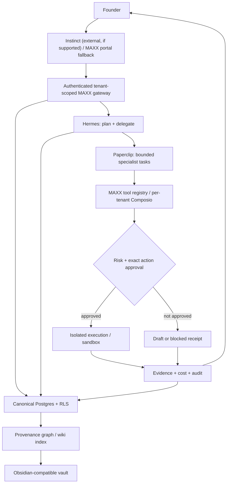

# MAXX client graph — human/Obsidian view

## Cold-start graph
The machine-readable source for workspace routing is `graph.json`. Each onboarding stage has its own `CONTEXT.md`; graph nodes link to these paths. Add business-specific nodes only after consent and evidence. Do not put names, raw transcripts or secrets in graph metadata.

## One authority, many views
- **Fact:** approved business record with source, tenant and freshness.
- **Inference:** model conclusion linked to facts; not promoted automatically.
- **Decision:** owner/authorized reviewer decision with timestamp and authority.
- **Evidence:** receipts, tests, artifacts and cost observations.
- **Projection:** Obsidian note, LLM wiki, OpenViking index, vector search; regenerable from authorized canonical records.

## Failover
If Instinct is unavailable, the same authenticated gateway can be called by the MAXX portal or a future approved client. If the inference model changes, Hermes reads the same ICM and capability contracts. If Hermes/Paperclip is unavailable, requests remain queued/blocked; the system never fabricates completion.
